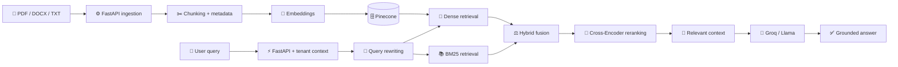
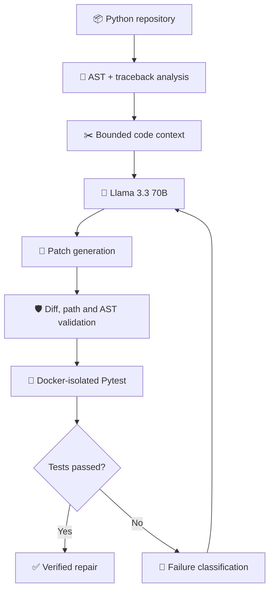
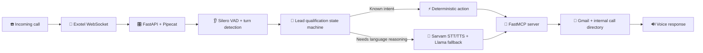
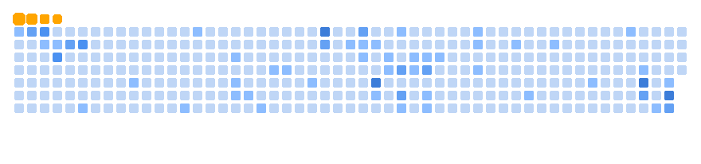

<table border="0">
<tr>
<td align="center" width="58%">
  <h3>⚡ Turning LLM capabilities into dependable software.</h3>
  
AI Engineer focused on retrieval quality, agent workflows, voice interfaces, and backend reliability.

  
  
  
</td>
<td align="center" width="42%">
  
</td>
</tr>
</table>

👋 About me
I'm Vamshi Durgam, an AI Engineer building LLM-powered applications, retrieval systems, agent workflows, and real-time voice experiences using Python and FastAPI.

I care about the engineering around the model call: data ingestion, retrieval quality, orchestration, evaluation, security, latency, and production reliability. I enjoy turning AI capabilities into useful backend systems rather than stopping at a prompt-and-response demo.

🧠 LLM applications	🔎 Retrieval engineering	🤖 Agentic workflows	🎙️ Voice AI
Structured outputs, tool calling	Hybrid search, reranking	LangGraph, MCP	Streaming STT/TTS, VAD

🗺️ How I think about AI systems
01 · RAG and knowledge retrieval

02 · Repository-level software repair agent

03 · Real-time Telugu voice agent

🚀 Featured builds

<strong>🧑‍💻 AI SWE Agent · Repository-level software repair</strong> 
Python · FastAPI · Groq · Llama 3.3 70B · AST · Docker · Pytest · Git

An LLM-driven software repair workflow that explores a repository, localizes bugs, proposes patches, executes tests, analyzes failures, and iteratively verifies repairs.
- 🧭 AST-based code analysis and traceback-driven localization to identify relevant repository symbols.
- 🧱 Bounded code-context construction to keep repair prompts focused.
- 🛡️ Unified Diff validation, path-traversal protection, AST validation, Git rollback, and isolated task workspaces.
- 🐳 Docker-isolated Pytest execution with structured failure classification and retry-based recovery.
Internal evaluation	Result
Python bugs evaluated	20
First-attempt resolution	85%
Resolution within three attempts	95%

<strong>🔎 Multi-Tenant RAG Backend · Hybrid retrieval and reranking</strong> 
Python · FastAPI · PostgreSQL · Pinecone · Groq · Llama · BM25 · Cross-Encoder

A tenant-aware RAG backend for customer-support knowledge bases and conversational queries.
- 🔎 Combined dense semantic retrieval with BM25 sparse retrieval, followed by Cross-Encoder reranking.
- 🧠 Implemented conversational query rewriting using Llama and PostgreSQL-backed conversation history.
- 📄 Built asynchronous PDF/DOCX/TXT ingestion, chunking, embedding generation, BM25 indexing, and batched vector upserts.
- 🔐 Added JWT authentication, tenant ownership validation, and metadata filtering.

<strong>🎧 Telugu AI Voice Agent · Real-time real-estate lead qualification</strong> 
Python · FastAPI · Pipecat · Exotel · FastMCP · Sarvam AI · Silero VAD · Llama · Groq

A real-time Telugu voice-agent pipeline for real-estate lead qualification over telephony, combining deterministic workflow logic with conversational AI fallback.
- ☎️ Integrated Exotel WebSockets with Sarvam streaming STT/TTS and Llama-based conversational fallback.
- 🔗 Built a custom MCP server using FastMCP to connect the voice agent with Gmail and internal call directories.
- 🎚️ Implemented bidirectional audio streaming, Silero VAD, turn detection, buffering, and μ-law media serialization.
- 📈 Added turn-latency instrumentation, token/context tracking, barge-in analytics, transcript logging, and SQLite/JSON persistence.

🧰 Engineering toolkit

Languages and backend
LLMs, orchestration and observability

Retrieval and search

Databases and infrastructure

Voice AI

Frontend/UI technologies are intentionally trimmed down; JavaScript and Next.js are retained as requested.
📈 GitHub stats

🐍 Contribution snake · animated

Alternative themes: <a href="https://raw.githubusercontent.com/Durgam-vamshi/Durgam-vamshi/output/github-snake.svg">light SVG</a> · <a href="https://raw.githubusercontent.com/Durgam-vamshi/Durgam-vamshi/output/github-snake-dark.svg">dark SVG</a>

🤝 Let's connect

Always happy to talk about GenAI engineering, RAG quality, agentic systems, Voice AI, and backend architecture.

DESIGN THE SYSTEM · BUILD THE WORKFLOW · MEASURE THE RESULT · SHIP IT

