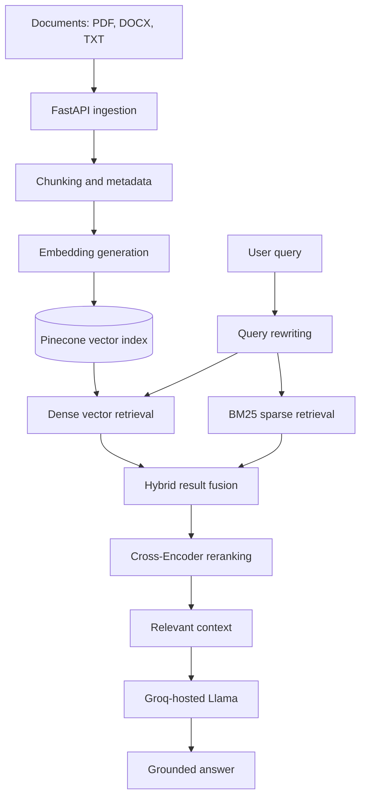
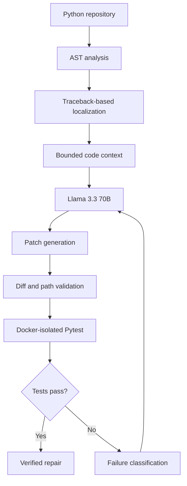
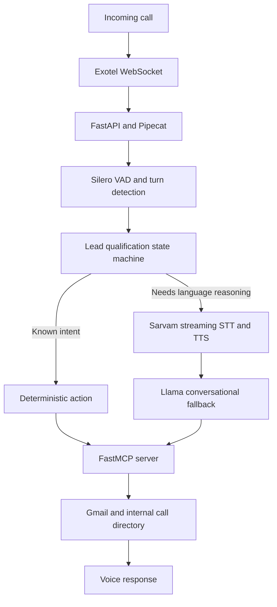

  

  

  
  
  
  

  
  
  
  

---

## ⚡ About me

I'm **Vamshi Durgam**, an **AI Engineer at Sync AI Technologies** building LLM-powered applications, retrieval systems, agent workflows, and real-time voice experiences using Python and FastAPI.

I focus on the engineering around the model call: **document ingestion, retrieval quality, orchestration, evaluation, security, latency, and backend reliability**. I enjoy turning AI capabilities into useful systems rather than stopping at a prompt-and-response demo.

  <strong>🧠 LLM Applications</strong> &nbsp; · &nbsp;
  <strong>🔎 Retrieval Engineering</strong> &nbsp; · &nbsp;
  <strong>🤖 Agentic Workflows</strong> &nbsp; · &nbsp;
  <strong>🎙️ Voice AI</strong>

---

## 🧭 How I think about AI systems

### 01 · RAG and knowledge retrieval

### 02 · Repository-level software repair agent

### 03 · Real-time Telugu voice agent

---

## 🚀 Featured builds

### 🧑‍💻 AI SWE Agent — Repository-level software repair

**Python · FastAPI · Groq · Llama 3.3 70B · AST · Docker · Pytest · Git**

An LLM-driven software repair workflow that explores a repository, localizes bugs, proposes patches, executes tests, analyzes failures, and iteratively verifies repairs.

- 🧭 Built AST-based code analysis and traceback-driven localization to identify relevant repository symbols.
- 🧱 Constructed bounded code context to keep repair prompts focused.
- 🛡️ Added Unified Diff validation, path-traversal protection, AST validation, Git rollback, and isolated task workspaces.
- 🐳 Implemented Docker-isolated Pytest execution, structured failure classification, and retry-based recovery.

| Internal evaluation | Result |
|:---|---:|
| Python bugs evaluated | **20** |
| First-attempt resolution | **85%** |
| Resolution within three attempts | **95%** |

### 🔎 Multi-Tenant RAG Backend — Hybrid retrieval and reranking

**Python · FastAPI · PostgreSQL · Pinecone · Groq · Llama · BM25 · Cross-Encoder**

A multi-tenant RAG backend for customer-support knowledge bases and conversational queries.

- 🔎 Combined dense semantic retrieval with BM25 sparse retrieval, followed by Cross-Encoder reranking.
- 🧠 Implemented conversational query rewriting using Llama and PostgreSQL-backed conversation history.
- 📄 Built asynchronous PDF, DOCX, and TXT ingestion with chunking, embedding generation, BM25 indexing, and batched vector upserts.
- 🔐 Added JWT authentication, tenant ownership validation, and metadata filtering.

### 🎧 Telugu AI Voice Agent — Real-time real-estate lead qualification

**Python · FastAPI · Pipecat · Exotel · FastMCP · Sarvam AI · Silero VAD · Llama · Groq**

A real-time Telugu voice-agent pipeline for real-estate lead qualification over telephony, combining deterministic workflow logic with conversational AI fallback.

- ☎️ Integrated Exotel WebSockets with Sarvam streaming STT/TTS and Llama-based conversational fallback.
- 🔗 Built a custom MCP server using FastMCP to connect the voice agent with Gmail and internal call directories.
- 🎚️ Implemented bidirectional audio streaming, Silero VAD, turn detection, buffering, and μ-law media serialization.
- 📈 Added turn-latency instrumentation, token/context tracking, barge-in analytics, transcript logging, and SQLite/JSON persistence.

---

## 🧰 Engineering toolkit

<strong>Languages and backend</strong>

  

<strong>LLMs, orchestration, and observability</strong>

  
  
  
  
  
  
  
  

<strong>Retrieval and search</strong>

  
  
  
  
  
  

<strong>Databases and infrastructure</strong>

  
   
  
  
  
  

<strong>Voice AI</strong>

  
  
  
  

---

## 📊 GitHub stats

  
  

---

## 🐍 Contribution snake

  <picture>
    <source media="(prefers-color-scheme: dark)" srcset="https://raw.githubusercontent.com/Durgam-vamshi/Durgam-vamshi/output/github-snake-dark.svg" />
    <source media="(prefers-color-scheme: light)" srcset="https://raw.githubusercontent.com/Durgam-vamshi/Durgam-vamshi/output/github-snake.svg" />
    
  </picture>

  If the snake is not visible immediately after adding the workflow, run the <a href="https://github.com/Durgam-vamshi/Durgam-vamshi/actions">GitHub Actions workflow</a> once to generate the images.

---

## 🤝 Let's connect

  I'm always interested in conversations about <strong>GenAI engineering, RAG quality, agentic systems, Voice AI, and backend architecture.</strong>

  
  
  

  <strong>DESIGN THE SYSTEM · BUILD THE WORKFLOW · MEASURE THE RESULT · SHIP IT</strong>

  

