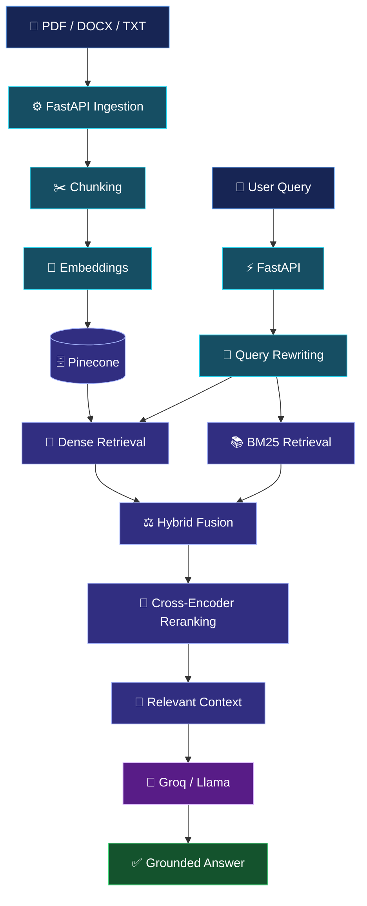
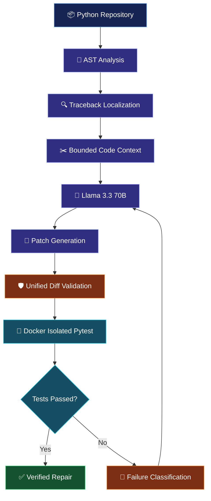
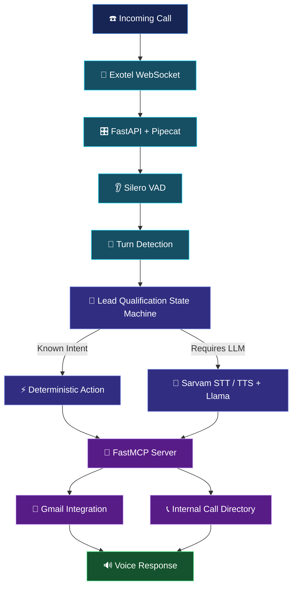

 

  

---

## ⚡ THE QUICK INTRO

I'm **Vamshi Durgam**, an **AI Engineer** building production-oriented LLM applications, retrieval systems, agent workflows, and real-time voice experiences.

I enjoy the engineering behind the model call:

- 🧠 LLM orchestration and AI agents
- 🔍 RAG pipelines and retrieval quality
- ⚡ Hybrid search, embeddings and reranking
- 🔗 MCP and tool/function calling
- 🎙️ Real-time conversational Voice AI
- 🏗️ Scalable asynchronous AI backend systems

My focus is turning AI capabilities into reliable, measurable systems that people can actually use.

### 🧠 LLM APPLICATIONS
### 🔍 RETRIEVAL ENGINEERING
### 🤖 AGENTIC WORKFLOWS
### 🎙️ REAL-TIME VOICE AI
### ⚙️ BACKEND ARCHITECTURE

---

# 🧩 THE SYSTEMS I BUILD

## 🔍 01 — RAG / KNOWLEDGE SYSTEMS

## 🛠️ 02 — AI SOFTWARE REPAIR AGENT

## 🎙️ 03 — REAL-TIME TELUGU VOICE AI

---

# 🚀 FEATURED BUILDS

<strong>🧑‍💻 AI SWE AGENT — REPOSITORY-LEVEL SOFTWARE REPAIR</strong>

An LLM-driven software repair workflow that analyzes repositories, localizes bugs, generates patches, executes tests, analyzes failures, and iteratively verifies repairs.

**Core engineering:**

- 🧭 AST-based code analysis and traceback-driven localization.
- ✂️ Bounded code context construction for relevant repository symbols.
- 🛡️ Unified Diff validation, path-traversal protection, AST validation, Git rollback and isolated task workspaces.
- 🐳 Docker-isolated Pytest execution.
- 🔄 Structured failure classification and retry-based recovery.

**Evaluation results**

| Metric | Result |
|---|---:|
| Internal Python bugs evaluated | 20 |
| First-attempt resolution | 85% |
| Resolution within three attempts | 95% |

**Stack:** Python · FastAPI · Groq · Llama 3.3 70B · AST · Docker · Pytest · Git

<strong>🔎 MULTI-TENANT RAG BACKEND — HYBRID RETRIEVAL & RERANKING</strong>

A multi-tenant RAG backend for customer-support knowledge bases using Python, FastAPI, PostgreSQL, Pinecone, and Groq-hosted Llama models.

**Core engineering:**

- 🔎 Two-stage hybrid retrieval combining dense semantic search with BM25 sparse retrieval.
- ⚖️ Cross-Encoder reranking to select high-relevance context.
- 🧠 Conversational query rewriting using Llama and PostgreSQL-backed conversation history.
- 📄 Asynchronous PDF/DOCX/TXT ingestion, chunking and embedding generation.
- 📦 BM25 indexing and batched vector upserts.
- 🔐 JWT authentication, tenant ownership validation and metadata filtering.

**Stack:** Python · FastAPI · PostgreSQL · Pinecone · Groq · Llama · BM25 · Cross-Encoder

<strong>🎧 REAL-TIME TELUGU AI VOICE AGENT — LEAD QUALIFICATION</strong>

A real-time Telugu voice-agent pipeline for real-estate lead qualification over telephony, integrating speech processing, deterministic workflows and AI-powered conversational fallback.

**Core engineering:**

- ☎️ Exotel WebSockets with Sarvam streaming STT/TTS.
- 🤖 Llama-based conversational fallback.
- 🔗 Custom MCP server using FastMCP to integrate Gmail and internal call directories.
- 🎚️ Bidirectional audio streaming, Silero VAD, turn detection and audio buffering.
- 📡 μ-law media serialization for telephony.
- 📈 Turn-latency instrumentation, token/context tracking, barge-in analytics and transcript logging.
- 💾 SQLite/JSON persistence for debugging conversational behavior.

**Stack:** Python · FastAPI · Pipecat · Exotel · FastMCP · Sarvam AI · Silero VAD · Llama · Groq

---

# 🧰 THE ENGINEERING TOOLKIT

## 💻 LANGUAGES & BACKEND

 

## 🧠 GENAI & ORCHESTRATION

 

## 🔍 RETRIEVAL & SEARCH

 

## 🗄️ DATABASES & INFRASTRUCTURE

 

 

## 🎙️ VOICE AI

---

# 📊 GITHUB COMMAND CENTER

  

---

# 🐍 THE CONTRIBUTION SNAKE

<picture>
  <source media="(prefers-color-scheme: dark)" srcset="https://raw.githubusercontent.com/Durgam-vamshi/Durgam-vamshi/output/github-contribution-grid-snake-dark.svg"/>
  <source media="(prefers-color-scheme: light)" srcset="https://raw.githubusercontent.com/Durgam-vamshi/Durgam-vamshi/output/github-contribution-grid-snake.svg"/>
  
</picture>

---

# 🤝 LET'S CONNECT

### Always interested in conversations around:

**GenAI Engineering • RAG Quality • Agentic Systems • Voice AI • Backend Architecture**

 

  

### ⚡ DESIGN THE SYSTEM. BUILD THE WORKFLOW. MEASURE THE RESULT. SHIP IT.

